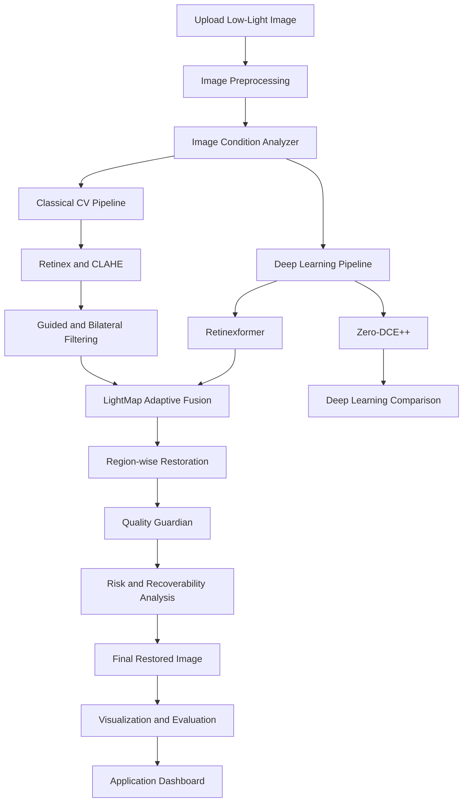

# LightMap – Explainable, Recovery-Aware Low-Light Image Restoration


**LightMap** is an intelligent hybrid Computer Vision and Deep Learning system designed to restore severely underexposed, noisy, colour-distorted and unevenly illuminated images.

Unlike conventional image enhancement applications that simply increase brightness, LightMap analyses different regions of an image, identifies their specific problems and applies suitable restoration strategies.

The system combines Classical Computer Vision, Deep Learning, adaptive image fusion and recovery-aware analysis to produce clearer and more natural-looking photographs.

---

## Phase 1 quick start

This repository now includes the Koushik-owned application foundation: a FastAPI backend, a React + Vite dashboard, structured integration placeholders for Karen and Krishank, and a working upload/validation pipeline with fallback handling.

### Backend

```bash
py -3.11 -m venv .venv
.venv\Scripts\activate
pip install -r backend/requirements.txt
copy backend\.env.example backend\.env
uvicorn app.main:app --host 0.0.0.0 --port 8000 --reload
```

### Frontend

```bash
cd frontend
npm install
copy .env.example .env
npm run dev -- --host 0.0.0.0
```

### API overview

- `GET /` - base service information
- `GET /health` - backend health status
- `POST /api/v1/analyze` - analyze uploaded image
- `POST /api/v1/enhance` - enhancement request with file upload and profile
- `POST /api/v1/compare` - comparison summary with original and enhanced output

> Phase 1 intentionally uses a documented demo fallback when optional restoration modules are unavailable. It never labels that output as a trained model result.

---

## Problem Statement

**PS1 – Robust Low-Light Image Restoration and Enhancement**

The objective is to develop an intelligent illumination-adaptive image restoration system capable of enhancing severely underexposed images while preserving:

- Fine textures and details.
- Object boundaries and edges.
- Natural colours.
- Structural information.
- Important highlights.

The system must handle different lighting conditions, sensor noise, colour distortion and non-uniform illumination without introducing excessive brightness, halo artifacts or unnatural colours.

---

## Project Vision

LightMap works like a smart restoration assistant.

Instead of applying the same enhancement to the entire photograph, it:

1. Analyses the uploaded image.
2. Identifies dark, noisy and overexposed regions.
3. Applies Classical CV and Deep Learning restoration techniques.
4. Makes region-wise adaptive restoration decisions.
5. Checks the quality of the restored result.
6. Identifies areas where original information may be difficult to recover.
7. Presents the final image with explainable visualizations.

**Our goal is not just to make dark images brighter, but to understand, restore and evaluate them intelligently.**

---

## Key Features

### 1. Classical Computer Vision

Traditional image-processing techniques for low-light restoration.

- Illumination estimation.
- Retinex-based image decomposition.
- Single-Scale and Multi-Scale Retinex.
- CLAHE (Contrast Limited Adaptive Histogram Equalization).
- Bilateral filtering.
- Guided filtering.
- Gamma correction.
- Colour correction.
- Adaptive enhancement parameters.

### 2. Deep Learning Restoration

Integration of pretrained deep-learning architectures.

**Retinexformer**
- Primary low-light restoration model.
- Illumination-guided restoration.
- Handles complex lighting conditions.

**Zero-DCE++**
- Lightweight enhancement model.
- Independent deep-learning comparison.
- Efficient inference.

### 3. LightMap – Region-wise Intelligent Restoration

Our primary differentiating feature.

The system analyses different regions of the image and determines how they should be processed.

Examples:

- Dark regions: Increase visibility.
- Noisy regions: Apply stronger denoising.
- Bright regions: Prevent overexposure.
- Detailed regions: Preserve textures and edges.
- Colour-distorted regions: Apply controlled colour correction.

### 4. Illumination-Aware Adaptive Fusion (IAAF)

Combines classical CV and deep-learning restoration outputs using spatially varying weights.

Rather than blindly averaging different enhancement outputs, the system analyses image characteristics and adapts the fusion strategy.

### 5. Restoration Risk and Disagreement Map

Identifies regions where restoration methods produce substantially different results or where image degradation may cause unreliable restoration.

### 6. Recoverability Map

Estimates which regions may contain recoverable visual information and which regions may have suffered severe information loss.

This is a heuristic estimate, not a guarantee of reconstruction accuracy.

### 7. Self-Auditing Quality Guardian

Checks the enhanced image for:

- Excessive brightness.
- Noise amplification.
- Colour distortion.
- Edge and texture loss.
- Highlight clipping.

The system can adjust restoration parameters and retry processing when quality constraints are violated.

### 8. Night Burst Restoration

An optional multi-image restoration mode.

Users can provide multiple photographs of the same scene. The system aligns compatible images and combines their information to reduce noise and improve restoration.

Motion detection and alignment correction are used to reduce ghosting artifacts.

### 9. Semantic-Aware Restoration

Uses object detection and image segmentation to identify important regions.

Examples:

- Human faces.
- Vehicles.
- Road signs.
- Buildings.
- Trees.

Different regions can receive different restoration priorities.

### 10. Vision Readiness Test

Compares downstream object detection on original and restored images using a pretrained YOLO model.

The purpose is to investigate whether low-light restoration improves the usefulness of images for subsequent Computer Vision tasks.

### 11. Adaptive Restoration Profiles

Users can choose between:

- **Natural Restoration:** Preserve the original appearance.
- **Maximum Visibility:** Prioritize visibility in dark areas.
- **Detail Preservation:** Prioritize textures, edges and noise control.

---

## System Architecture



---

## Technology Stack

| Component | Technology |
|---|---|
| Programming Language | Python |
| Computer Vision | OpenCV, NumPy |
| Deep Learning | PyTorch |
| Primary Model | Retinexformer |
| Lightweight Model | Zero-DCE++ |
| Object Detection | YOLO |
| Image Segmentation | Pretrained segmentation models |
| Backend | FastAPI |
| Frontend | React, TypeScript, Vite |
| Data Visualization | Matplotlib, Plotly |
| Evaluation | PSNR, SSIM, LPIPS, NIQE |
| Version Control | Git, GitHub |

---

## Datasets

The following datasets are planned for model evaluation and development.

| Dataset | Purpose |
|---|---|
| LOL | Paired low-light and normal-light images |
| LOL-v2 Real | Primary paired low-light benchmark |
| LOL-v2 Synthetic | Additional robustness evaluation |
| MIT-Adobe FiveK | Supplementary colour-enhancement evaluation |

Dataset usage, preprocessing and train/validation/test separation will be documented separately.

Dataset images and large files will not be committed to the repository.

---

## Evaluation Methodology

LightMap will compare three major restoration approaches:

1. Classical Computer Vision only.
2. Deep Learning only.
3. Hybrid adaptive restoration.

Additional comparisons will include Zero-DCE++ and fixed-weight fusion.

### Evaluation Metrics

| Metric | Purpose |
|---|---|
| PSNR | Reconstruction quality |
| SSIM | Structural similarity |
| LPIPS | Perceptual image quality |
| NIQE | No-reference image quality |
| Latency | Processing speed |
| Noise Suppression | Noise reduction |
| Edge Preservation | Retention of important boundaries |

PSNR, SSIM and LPIPS will be evaluated using suitable aligned reference images.

NIQE and other no-reference methods will be used for images without ground-truth references.

### Ablation Study

Individual components will be removed to measure their contributions.

- Without CLAHE.
- Without edge-preserving filtering.
- Without colour correction.
- Without illumination-aware analysis.
- Without adaptive fusion.
- Without recoverability analysis.

### Failure Case Analysis

The system will be tested on:

- Extremely dark images.
- Heavy sensor noise.
- Uneven illumination.
- Bright light sources surrounded by dark regions.
- Severe colour distortion.
- Images containing unrecoverable information loss.

Actual experimental results will be documented after evaluation.

---

## Repository Structure

```text
LightMap-Low-Light-Restoration/
│
├── backend/
│   └── app/
│       ├── api/
│       ├── classical_cv/
│       ├── deep_learning/
│       ├── hybrid/
│       ├── evaluation/
│       ├── visualization/
│       ├── utils/
│       ├── schemas/
│       └── main.py
│
├── frontend/
│   └── src/
│       ├── components/
│       ├── pages/
│       ├── services/
│       ├── hooks/
│       └── styles/
│
├── notebooks/
│   ├── 01_dataset_analysis.ipynb
│   ├── 02_classical_cv.ipynb
│   ├── 03_retinexformer.ipynb
│   ├── 04_zero_dce.ipynb
│   ├── 05_hybrid_fusion.ipynb
│   └── 06_evaluation.ipynb
│
├── datasets/
├── pretrained_weights/
├── experiments/
├── scripts/
├── docs/
├── tests/
│
├── .env.example
├── .gitignore
├── README.md
└── Dockerfile
```

---

## Installation and Setup

### Prerequisites

- Python 3.10 or compatible version.
- Node.js and npm.
- Git.
- VS Code.
- Google Colab or another suitable GPU environment for model development.

### 1. Clone the repository

```bash
git clone https://github.com/YOUR_USERNAME/LightMap-Low-Light-Restoration.git

cd LightMap-Low-Light-Restoration
```

### 2. Create a Python environment

Windows:

```bash
python -m venv .venv

.venv\Scripts\activate
```

Linux/macOS:

```bash
python3 -m venv .venv

source .venv/bin/activate
```

### 3. Install backend dependencies

```bash
pip install -r backend/requirements.txt
```

Install the appropriate PyTorch build for your hardware using the official PyTorch installation instructions.

### 4. Start the backend

```bash
uvicorn app.main:app --app-dir backend --reload
```

Backend API:

```text
http://localhost:8000
```

API documentation:

```text
http://localhost:8000/docs
```

### 5. Start the frontend

```bash
cd frontend

npm install

npm run dev
```

The frontend development URL will be displayed in the terminal.

---

## Pretrained Models

Model checkpoints are managed separately from the source code.

**Retinexformer**

Official repository:

https://github.com/caiyuanhao1998/Retinexformer

**Zero-DCE++**

Research and implementation:

https://li-chongyi.github.io/Proj_Zero-DCE++_main.html

Refer to `docs/model_setup.md` for checkpoint configuration and installation instructions.

---

## Experimental Reproducibility

All experiments should record:

- Dataset and split.
- Model and checkpoint version.
- Image resolution.
- Processing parameters.
- Hardware configuration.
- Random seed, where relevant.
- Evaluation metrics.
- Processing latency.

No experimental results or performance claims will be reported without actual measurements.

---

## Hackathon Deliverables

The project will provide:

- Live hosted application URL.
- GitHub source repository.
- System architecture diagram.
- Detailed design document.
- Comparative evaluation results.
- Ablation study.
- Failure-case analysis.
- Evaluation report named `eval_P1_TeamID.md`.

The evaluation report will follow the hackathon instructions, with all team members' USNs on the first line.

---

## Project Status

**Current Stage:** Development and experimentation.

Features listed in this README describe the planned project scope. Their implementation status will be updated as individual modules are developed, tested and integrated.

---

## Team

**Project:** LightMap

**Hackathon:** Computer Vision Hackathon 2026

**Problem Statement:** P1 – Robust Low-Light Image Restoration and Enhancement

Team Members:

- Member 1 – Name / USN
- Member 2 – Name / USN
- Member 3 – Name / USN
- Member 4 – Name / USN

---

## Project Objective

To develop a hybrid, intelligent and explainable low-light restoration system that does more than increase image brightness.

**LightMap – Understand the image. Restore intelligently. Verify the result.**
